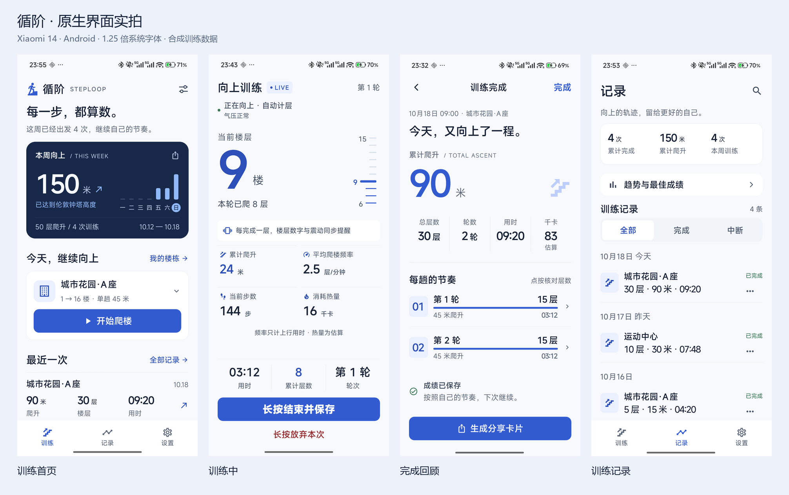
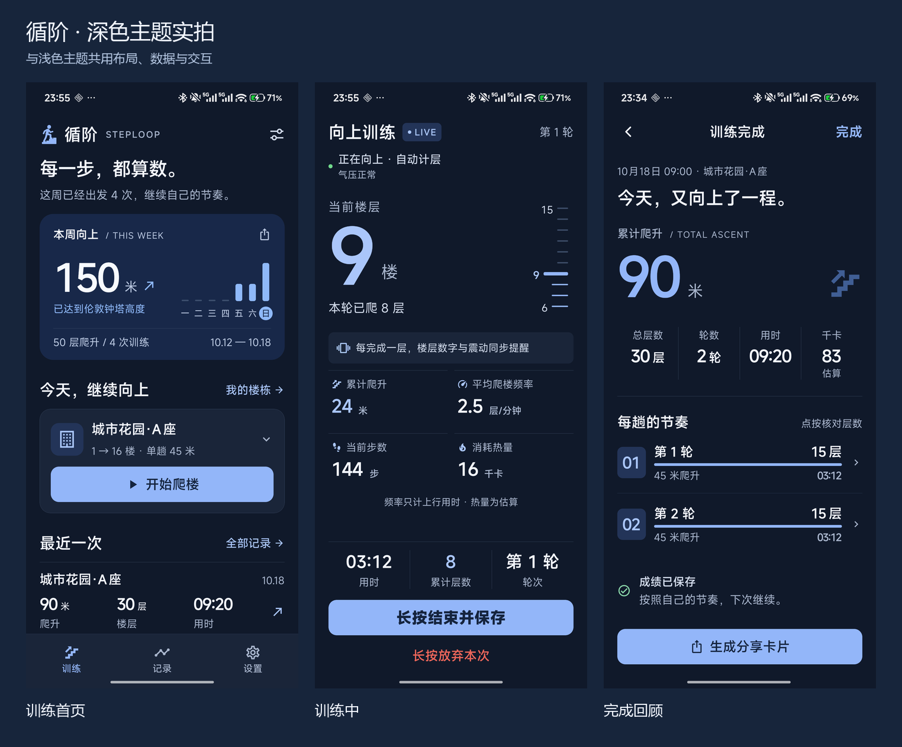

# 循阶 1.1.4 界面与真机升级验收

完成时间：2026-10-19（北京时间）。设计与构建开始于 2026-10-18。

## 交付结果

训练首页、运动中、训练完成、记录、设置和周成果分享采用同一套冷白 / 深蓝与钴蓝视觉。首页展示真实七天训练与常用楼栋；运动中突出当前楼层和楼层刻度；完成页使用紧凑的每轮记录；记录页保留历史口径并增加楼栋 / 日期搜索。

设计依据与页面映射见 [设计说明](../../UI_SPORT_SYSTEM_20261018.md)。本次接受的设计基准是完整体验及设计原则，没有像素原稿可做逐像素差异评分。以下图片来自 Android 原生渲染。

## 原生显示与交互

设备：Xiaomi 14，1200 × 2670，480 dpi，系统字体缩放 1.25。公开实拍使用独立 `com.zxn.palou.uiqa` 包中的合成数据；正式包的个人训练截图和原始备份保存在源码目录之外。

| 检查 | 结果与证据 |
|---|---|
| 首页浅色 / 深色 | 本周、七天条形图、开练入口、最近一次均使用实际记录；统一色彩和数字层级。`home-light` / `home-dark` |
| 新用户与长楼栋名 | 零值不伪造活动；长名称可换行，开练按钮可见。`empty-light` / `home-long-light` |
| 楼栋选择 → 开始 | 打开楼栋列表，选择“运动中心”，进入对应训练夹具。`building-picker-light` / `building-selected-light` / `home-to-workout-light` |
| 运动显示 | 标定、上行、下行和深色上行状态均有原生实拍；结束和放弃继续保持原有长按行为。`calibrating-light` / `climbing-light` / `descending-light` / `climbing-dark` |
| 训练返回保护 | 系统返回后出现“训练仍在进行”的保护提示。`workout-back-guard-light` |
| 单轮与多轮结算 | 一轮紧凑展示，多轮保留逐轮核对入口；浅色 / 深色均检查。`summary-single-light` / `summary-light` / `summary-dark` |
| 保存失败 | 展示未保存说明、保留的本次成绩和重试入口；没有将截图检查当作存储故障恢复实测。`save-failed-light` |
| 搜索与清空 | 原生打开搜索，输入不存在的词后为 0 条，清空后恢复 4 条合成记录。`history-search-empty-light` / `history-search-cleared-light` |
| 正式安装 | `com.zxn.palou` 从 1.1.3 / 12 原位升级为 1.1.4 / 13；首页读取原有楼栋与最近训练，记录页显示 51 条，历史训练详情可以打开，导出成功。 |

`actual/` 同名 PNG 与 XML 保留完整证据；总览仅缩放排列原始截图。界面曾按 1.25 倍字体的实拍调整首页及记录页密度。

## 代码与安装包

- 全量 `npm test`：617 项，584 通过、0 失败、33 项既有跳过。
- 最后一次界面安全、主题及原生隔离检查：22 通过、0 失败。
- 最后一次 `npx tsc --noEmit` 与 `git diff --check` 通过。
- Android ARM64 release 构建成功，包名 `com.zxn.palou`，非 debuggable，版本 1.1.4 / 13。
- 证书 SHA-256 与旧安装包一致：`fac61745dc0903786fb9ede62a962b399f7348f0bb6f899b8332667591033b9c`。
- APK SHA-256：`b21d0627a2e6ebdf7acae45b5a80b3f9f1bcce220de48cef941359827f6d041a`。
- 正式 Hermes bundle 中未发现 `uiqa-summary`、`uiqa-building-a`、`uiqa-live` 或 QA 预览 URL；生成的 release BuildConfig 为 DEBUG=false。
- 日志与完整安装验证位于交付目录 `output/ascent-sport-20261018/`。

## 数据保留

安装前后分别通过正式应用“保存备份到下载”导出，并在电脑保留独立副本。对两个备份所有键递归比对，仅排除 `exportedAt`，结果完全一致：51 次训练、2 个楼栋模板、1 条旧版路线；训练内容、楼栋内容、旧记录、隐藏路线与归档元数据也一致。

使用 `adb install -r`，未卸载、清空、导入或修改正式训练数据。首次安装时间保持不变。原有脏工作区与此前夜景原型已保留，本次源码在独立分支 `codex/ascent-sport-system-20261018`。

验收后已移除独立的合成数据测试包，并停止本次 Metro 服务和 ADB 8081 转发；正式应用留在训练首页，可独立运行。

## 验证边界

这次验收覆盖界面、已有关键流程回归、正式升级和导出数据保留。原始传感器文件与备份范围以外的偏好项未逐字节比较；未进行新的实际爬楼、锁屏连续采样或计层精度验收。结算修正与故障重试依赖既有回归检查，本轮没有把合成夹具计入实际运动证明。
