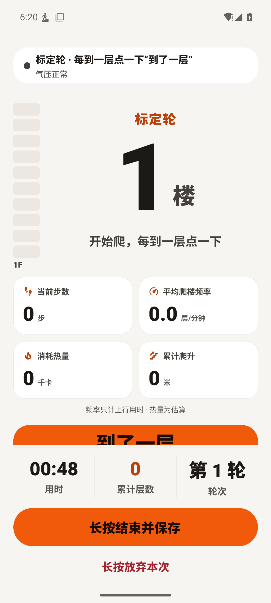
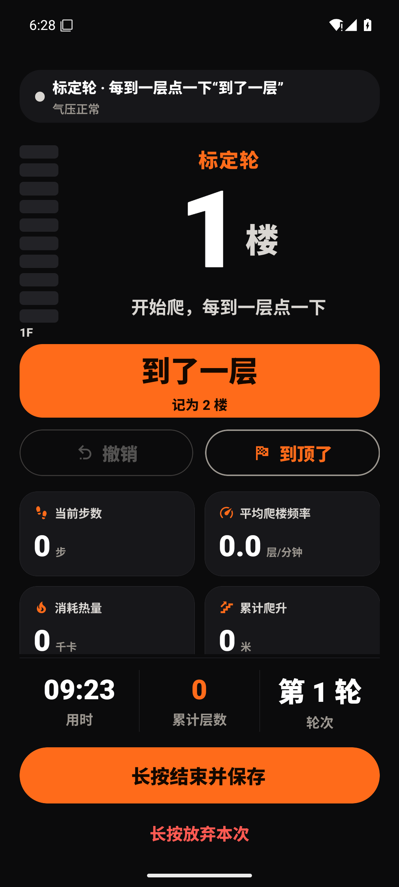

# 2026-10-15 原生界面与数据流程验收

本目录是本轮实际Android截图，不是设计稿或历史发布图册。测试对象为独立包 `com.zxn.palou.audit20261015`，API35 x86_64、全新模拟器 `codex_steploop_20261015`。没有读取、清空或覆盖真实手机数据。

正常尺寸为1080×2400、density420、字体1.0；小屏检查为360×640dp、字体1.3。训练数据均为合成输入，不代表真实爬楼精度。最终包内嵌JS，无需Metro；应用源文件已与整合目录逐文件核对。

## 关键发现与修复

标定主按钮原先被实时指标挤到屏幕下方。把标定操作移到指标前并压缩数字区域后，普通屏和小屏大字体下主按钮均可见。小屏的撤销、到顶和部分指标仍需要滚动；不宣称所有内容同时可见。

| 修复前：主要操作被挤出首屏 | 修复后：主要操作在首屏 |
| --- | --- |
|  |  |

## 实测流程

| 编号 | 检查与结果 | 证据 |
| --- | --- | --- |
| 01 | 首次启动展示当前隐私说明，确认后进入引导 | [隐私](01-privacy.png) |
| 02 | 依次完成3步引导；截图记录第1步 | [引导](02-onboarding.png) |
| 03 | 浅色空首页与开始入口 | [首页](03-home-light.png) |
| 04 | 标定修复前，主要按钮部分落在首屏外；保留为问题证据 | [修复前](04-calibration.png) |
| 05 | 训练中强制停止应用，再打开后出现恢复入口 | [恢复](05-recovery.png) |
| 06 | 深色首页仍保留恢复入口 | [深色首页](06-home-dark.png) |
| 07 | 深色设置、权限状态 | [设置](07-settings-dark.png) |
| 08 | 备份说明与实际能力一致；原生XML中的导航/导出标签明确 | [备份设置](08-backup-dark.png) |
| 09 | 修复后普通屏标定主操作完整可见 | [修复后](09-calibration-fixed-dark.png) |
| 10 | 360×640dp、字体1.3下首页和恢复入口可见 | [小屏首页](10-small-large-font.png) |
| 11 | 小屏大字体恢复训练后标定主操作可见，次要内容可滚动 | [小屏标定](11-calibration-small.png) |
| 12 | 系统动画比例设为0，短按放弃按钮不会放弃训练 | [短按](12-short-tap-retains-training.png) |
| 13 | 同一条件下实际长按1.5秒返回首页，恢复入口消失 | [长按](13-long-hold-discards.png) |
| 14 | 没有训练时周报显示空状态与返回训练入口 | [空周报](14-weekly-share.png) |
| 15 | 原生文件选择器读取合成备份；预览识别1条训练与1个楼栋 | [导入预览](15-import-preview.png) |
| 16 | 确认合并导入成功；记录显示2层、6米、1次合成训练 | [历史记录](16-imported-history.png) |
| 17 | 首页同步展示导入楼栋与周累计；再次导出对象与输入一致 | [有数据首页](17-imported-home.png) |
| 18 | 周报显示相同汇总，画面不含楼栋名称与逐次训练详情 | [周报页面](18-weekly-populated.png) |
| 19 | 点击保存海报后返回成功信息，相册产生1080×1350 PNG；实际文件已拉取检查 | [导出的海报](19-exported-weekly-poster.png) |

备份往返核验：version=2，buildings=1，workouts=1，hiddenLegacyRouteIds=[]；楼栋与训练对象分别与输入逐字段相等。空数据备份也已实际写入Download/循阶并检查新字段。合成输入与原始运行日志保留在本机output目录，未混入真实用户资料。

## 证据边界与下一步验收

- 本轮原生检查是人工操作覆盖；自动故障注入另见[总报告](../../INTEGRATION_AUDIT_20261015.md)。强制停止恢复不能代表全部存储故障或渲染异常都已原生验收。
- 没有完成TalkBack焦点/全流程读屏、所有屏幕尺寸或所有字体比例验证。
- 配置切换出现React Native Surface/LeakChecker日志告警。需追加长期内存与重复配置切换分析；当前流程成功不等同于不存在内存问题。
- 真机计层准确率、不同携带位置、下楼/电梯区分、锁屏采样、功耗和保留真实数据的正式升级仍需实体设备验收。
- 覆盖导入、撤销与旧备份兼容具有源码回归证据，本轮原生实测仅覆盖合并导入和导出往返。
- 相册保存已实测；没有向其他人或外部平台实际发送周报。

下一阶段应先完成真实手机运动与后台采样矩阵，再制作ARM正式签名候选包做保留数据的升级验证。19个高等级依赖告警节点及两项网络未完成的Doctor检查也必须持续跟踪，详见总报告。
